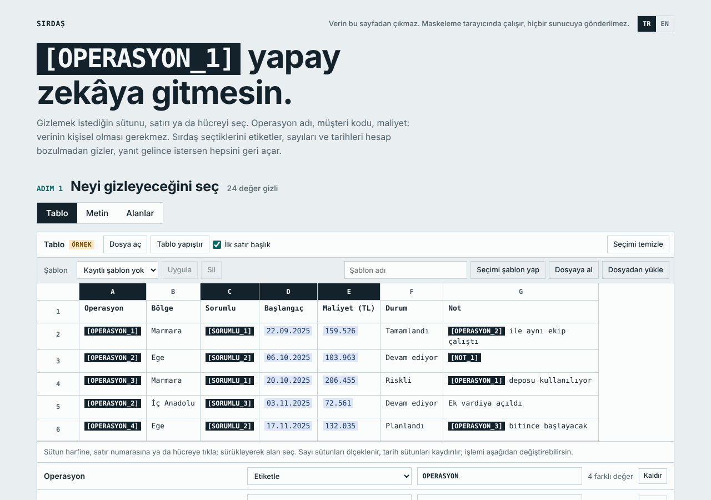

# Sırdaş

**Yapay zekâya göndermeden önce Excel, Word, PowerPoint, JSON, XML, PDF ya da metinde seçtiğin değerleri maskeleyen, yanıtı geri açan araç. Operasyon adı, müşteri kodu, maliyet: verinin kişisel olması gerekmez. Tarayıcıda çalışır, veri hiçbir sunucuya gitmez. Türkçe ve İngilizce; ayrıca Excel eklentisi ve yerel MCP sunucusu.**

- **Web (Türkçe):** https://sirdas.ysfdurak.com/
- **Web (English):** https://sirdas.ysfdurak.com/en/
- **Excel eklentisi:** [docs/EKLENTI.md](docs/EKLENTI.md)
- **MCP (Claude Desktop vb.):** [docs/MCP.md](docs/MCP.md)

> **English:** Sırdaş masks the columns, rows and cells you choose in an Excel table or text before you send it to an AI, and puts the real values back into the answer. Numbers can be scaled by a hidden factor (totals and ratios stay right), dates shifted by whole weeks, columns removed or grouped. Templates remember your choices by header name; an encrypted key file keeps labels consistent across sessions. Excel keeps its formatting; Word and PowerPoint are masked in place with their layout; JSON and XML are masked by field path; PDF text can be extracted and masked. Runs in the browser; nothing is uploaded. An Excel add-in and a local MCP server use the same core; AI assistants only ever see the masked data.



## Hangi biçimler?
| Biçim | Nasıl seçilir | Çıktı |
|---|---|---|
| Excel (.xlsx, .xlsm) | Sütun, satır, hücre; birden çok sayfa | Biçimi korunmuş maskeli .xlsx |
| Excel (.xls, .ods), CSV | Aynı | Değerlerle yeni .xlsx ya da kopyalanan tablo |
| Word (.docx), PowerPoint (.pptx) | Seçtiğin ifadeler, daha önce gizlenen değerler, istersen kişisel veriler | Biçimi korunmuş maskeli belge |
| JSON, XML | Alan yolu (`kayitlar[].musteri.ad`, `Liste/Musteri/@vkn`) | Yapısı aynen kalan maskeli dosya |
| PDF | Metin olarak, Word gibi | Maskeli metin (PDF görünümü korunmaz) |
| Düz metin | Seçtiğin ifadeler ve kişisel veriler | Maskeli metin |

Aynı anahtar bütün biçimlerde geçerlidir: Excel'de `[OPERASYON_1]` olan değer Word'de, JSON'da ve PDF'te de `[OPERASYON_1]` olur.

## Neler var?
- **Sen seçersin:** Sütun harfine, satır numarasına ya da hücreye tıkla, sürükleyerek alan seç. Başlık hücresi de gizlenebilir. Metin görünümünde seçtiğin parçaya kendi etiketini verirsin (`[PLAN_1]`).
- **Sütun başına işlem:**
  - **Etiketle:** `Proje Atlas` → `[OPERASYON_1]`. Aynı değer her yerde ve her mesajda aynı etiketi alır.
  - **Çıkar:** Sütun hiç gönderilmez; değerleri başka hücrelerde geçerse orada etiketlenir.
  - **Katsayıyla ölçekle:** Tüm sayılar aynı gizli katsayıyla çarpılır. Toplam, ortalama ve oranlar doğru kalır; yanıttaki sonuçlar geri çevrilir.
  - **Aralığa çevir:** `412.000` → `400 bin–500 bin`. Geri çevrilmez.
  - **Tarihi kaydır:** Tüm tarihler aynı gizli sayıda tam hafta kayar. Süreler ve haftanın günü korunur; yanıtta geri kaydırılır.
  - **Grupla:** `Kadıköy` → `İstanbul` gibi kendi eşlemen. Geri çevrilmez.
- **Başka hücrelerde de gizler:** Gizlediğin `Proje Atlas` bir not hücresinde geçiyorsa orada da etiketlenir.
- **Şablonlar:** Seçimini başlık adlarıyla kaydet; aynı başlıklı her yeni dosyada tek tıkla uygula. Sütunun yeri değişse de çalışır. Şablon `.json` dosyası olarak alınıp verilebilir ve MCP sunucusu da aynı dosyayı kullanır.
- **Anahtar dosyası:** Etiketler, sayı katsayısı ve tarih kaydırması parolayla şifrelenip (PBKDF2-SHA256 250.000 tur + AES-GCM 256) dosyaya alınır. Ertesi gün yükleyince aynı değerler aynı etiketleri alır.
- **Çok sayfalı Excel:** Her sayfa ayrı seçilir, hepsi tek dosyada maskelenir. Sayfa adları `Sayfa 1, 2…` olarak gizlenir ve geri açarken eski adlarına döner.
- **Göndermeden kontrol:** Kaç değerin gizlendiğini ve hangi sütunların çıkarıldığını gösterir. Açık kalan gizli değerleri, etiket adından sızan değerleri, seçim yapılmamış sayfaları ve açık giden başlıkları da listeler.
- **Biçimi koruyan Excel çıktısı:** Renk, yazı tipi, sayı biçimi ve sütun genişliği kalır; değeri sızdırabilecek her şey temizlenir:
  - formüller değere çevrilir;
  - notlar, açılır listeler, koşullu biçim kuralları, tablo tanımları, görseller ve tanımlı adlar silinir;
  - yazar ve şirket bilgisi silinir;
  - Excel'de gizli olan sayfalar varsayılan olarak alınmaz.

  Dosya adı sabittir (`sirdas-maskeli.xlsx`). İstenirse biçimsiz, yalnızca değerli çıktı da alınır.
- **Word ve PowerPoint, biçimiyle:** Değerler gövdede, tablolarda, üst ve alt bilgide, dipnotlarda, yorumlarda, konuşmacı notlarında, grafik etiketlerinde ve bağlantı adreslerinde gizlenir. Bir değer farklı biçimli parçalara bölünmüş olsa da ("**Proje** Atlas") tek etikete döner. Belge özellikleri, yorum ve değişiklik yazarları, önizleme resmi temizlenir; gömülü grafik verisi boşaltılır.
- **JSON ve XML'de alan seçimi:** Alanlar adetleri, türleri ve örnekleriyle listelenir; işaretlenen alan her kayıtta gizlenir. Yapı ve XML biçimi aynen kalır; "çıkar" alanı ya da öğeyi tamamen siler.
- **PDF:** Metni sayfa sayfa çıkarılır ve metin gibi maskelenir. Taranmış PDF'te metin yoktur; metin tanıma (OCR) bu araçta yoktur.
- **Excel eklentisi:** Sütunu ya da hücreyi Excel'in içinde seçersin. Maskeli kopya biçimiyle yeni kitap olarak açılır; yapay zekânın döndürdüğü kitap yerinde geri açılır ve formüllere dokunulmaz.
- **Geri açma:** Yanıtı yapıştır ya da yapay zekânın döndürdüğü Excel, Word, PowerPoint, JSON ya da XML dosyasını aç; açılmış hali biçimiyle iner. Etiketler, ölçeklenmiş sayılar ve kaydırılmış tarihler geri çevrilir. Metinde her sayı tek tıkla açılıp kapanır. Bilinmeyen etiketler ve Türkçe ek uyumu (`Kerem Tan'in`) için uyarı verir.
- **İsteğe bağlı kişisel veri tespiti:** Ad soyad, T.C. kimlik (kontrol haneli), vergi no, IBAN, kart (Luhn), telefon, e-posta, adres, firma, plaka, IP.
- **Büyük dosyalar:** Hesap arka planda (Web Worker) çalışır, sayfa donmaz. 40.000 satırlık bir tablo yaklaşık 1 saniyede maskelenir.
- **İki dil, internetsiz çalışma:** Türkçe ve İngilizce. İlk açılıştan sonra internet olmadan da çalışır (`sw.js`).

## Nasıl çalışıyor?
- **Tek çekirdek:** Maskeleme mantığının tamamı `src/core.js` dosyasında, Office dosyaları `src/ofis.js` dosyasında. Web arayüzü (`src/app.js`), arka plan hesaplayıcısı (`src/worker.js`), Excel eklentisi (`eklenti/`), MCP sunucusu (`mcp/`) ve testler aynı dosyaları kullanır.
- **Sunucu yok:** Hesaplar tarayıcıda yapılır. SheetJS 0.20.3, ExcelJS 4.4.0, JSZip 3.10.1, pdf.js 4.10.38 ve yazı tipleri depodaki `lib/` klasöründen gelir; ilk kullanımda yüklenir. Sayfanın güvenlik kuralı (CSP, `connect-src 'self'`) başka adrese bağlantıyı tarayıcı düzeyinde engeller.
- **Kayıt yok:** Tablolar, metinler ve anahtar yalnızca sayfanın belleğinde durur; sayfa kapanınca silinir. Tarayıcıda saklanan tek şey şablonların ve dil seçimin.
- **Ayrıntı:** Geliştirici notları ve projeyi anlatabilmen için hazırlanmış rehber: [docs/GELISTIRME.md](docs/GELISTIRME.md).

## Sınırlar
- **Seçmediğin hücreler olduğu gibi gider.** Bağlam da ele verebilir: ad gizlense de bölge, tarih ve tutar birlikte bir operasyonu tanıtabilir.
- **Ölçekleme şifreleme değildir.** Oranlar korunduğu için tek bir gerçek değeri bilen biri katsayıyı bulabilir. Rakamın kendisi hassassa aralığa çevir ya da sütunu çıkar.
- **Bu, takma adlandırmadır.** Anahtar var oldukça veri geri çevrilebilir, yani anonim sayılmaz. Kurum verisinde şirket kuralların ve KVKK yükümlülüklerin geçerliliğini korur.
- **Görsellerin içindeki yazılar gizlenmez.** Word, PowerPoint ve Excel'deki resimler değiştirilmez (Excel'de görseller silinir).
- **Metin olarak ölçeklenen sayılar yuvarlanabilir.** Excel ve JSON'daki sayı hücreleri iki ondalık fazla saklandığı için tam döner; metin içinde yazılmış sayılarda (`412.000`) geri çevrilen değer ±1 sapabilir.

## Geliştirme
```bash
npm run build     # web/source.html + src/*.js → index.html, en/index.html, dist/artifact.html
npm test          # çekirdek (23), ofis (4) ve MCP uçtan uca testleri (önce: cd mcp && npm install)
npm run serve     # http://localhost:8000/
```

## Yayın
Canlı adres **sirdas.ysfdurak.com**. Yayın Cloudflare Workers üzerinden yapılır ve `main` dalına her gönderimde otomatik çalışır. Ayarlar `wrangler.jsonc` dosyasında, yayına girmeyen dosyalar `.assetsignore` dosyasında. `index.html` ve `en/index.html` derleme çıktısıdır; kaynağı değiştirdikten sonra `npm run build` çalıştırıp ikisini de gönder.

## Nasıl yapıldı?
Ürünü, kapsamı ve sınırlarını Yusuf Durak belirledi; kod yapay zekâ (Claude) ile geliştirildi. İlk sürüm “Örtü” adıyla bir claude.ai artifact'ı olarak yapıldı. 1.0 sürümünde sütun ve hücre seçimi öne alındı; şablonlar, sayı ve tarih koruma, çok sayfa, son kontrol ve MCP sunucusu eklendi. 1.1 sürümünde Excel eklentisi, biçimi koruyan Excel, Word, PowerPoint, JSON/XML ve PDF desteği eklendi.

## Lisans

Bu proje [PolyForm Shield 1.0.0](LICENSE.md) lisansıyla yayınlanır. Kaynak kodu açıktır, ancak resmi anlamda bir "açık kaynak" lisansı değildir.

- **Serbest:** Kişiler, okullar ve şirketler kendi işlerinde ücretsiz kullanabilir, değiştirebilir ve kendi bilgisayarlarına ya da sunucularına kurabilir. İzin almak gerekmez.
- **Yazılı izin gerekir:** Yazılımı satmak, adını değiştirip ürün gibi sunmak ya da bununla (ücretsiz olsa bile) rakip bir ürün veya hizmet sunmak.
- **Garanti yok:** Yazılım olduğu gibi sunulur. Bağlayıcı olan İngilizce lisans metnidir.
- Üçüncü taraf bileşenler kendi lisanslarına tabidir (`lib/lisanslar/`).

**Kurum içinde kurmak:** Depoyu indir, `npm run build` çalıştır ve klasörü herhangi bir iç web sunucusunda (IIS, nginx, Apache) yayınla. Dış bağlantı olmadığından kapalı ağda da çalışır. Excel eklentisi için [docs/EKLENTI.md](docs/EKLENTI.md), MCP sunucusu için [docs/MCP.md](docs/MCP.md).

Kurumunuzda kullanıyorsanız haber verirseniz sevinirim: kurulumda yardımcı olabilir, kurumunuza özel ihtiyaçları birlikte değerlendirebiliriz. İletişim: iletisim@ysfdurak.com

### License (English)

Released under [PolyForm Shield 1.0.0](LICENSE.md). The source is available, but this is not an OSI "open source" licence.

- **Free:** individuals, schools and companies may use it in their own work, change it and run it on their own computers or servers. No permission needed.
- **Needs written permission:** selling it, rebranding it as a product, or providing a product or service that competes with it (even free of charge).
- **No warranty:** provided as is. The English licence text is binding.
- Third-party components keep their own licences (`lib/lisanslar/`).

**Running it inside your organisation:** download the repository, run `npm run build` and serve the folder from any internal web server (IIS, nginx, Apache). It makes no outside connections, so it also works on closed networks. For the Excel add-in see [docs/EKLENTI.md](docs/EKLENTI.md), for the MCP server [docs/MCP.md](docs/MCP.md).

Using it in your organisation? I'd be glad to hear from you: I can help with setup and look at your organisation's needs together. Contact: contact@ysfdurak.com
